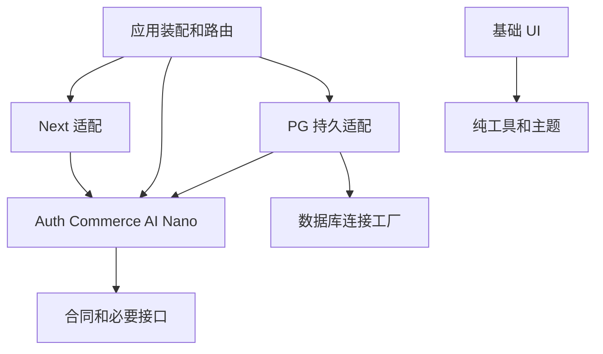

# Nexty 平台迁移与模块拆分计划

## 0 当前实施状态与暂停/续接（2026-11-10）

本节为 2026-11-10 实施状态入口，加入于顶部旧历史声明之前；第 1 节起的原合同和历史清单保持原样，未重排、未格式化。

- 当前分支 `codex/nexty-platform-overnight-20261105`，实施基线 HEAD `709dbb70`。N1–N3、N5 已获本地批准；N4 为本地登录态合成浏览器批准，整体真实外部门槛尚未批准。
- 本轮（2026-11-10）仅完成文档收尾：新增 [TODO.md](../../TODO.md) 并加入本节，PUSH 由主控执行，本节不声明 push 结果。
- 暂停状态：文档收尾后暂停，停在 Review；其余任务暂停，未开始任何待办实施。
- 续接顺序（需用户明确恢复）：只读核对 HEAD/dirty/index 与实际资源归属 → 沿用四模型池 → 选一项本地 P2 轻量实施并独立 Review → 外部待验组仅在具体合同输入/授权满足后按依赖推进。
- 待办明细与外部待验四组见 [TODO.md](../../TODO.md)；外部验收入口见 [docs/external-acceptance.md](../external-acceptance.md)。
- 约束：不合并、不部署、不生产迁移、不真实 provider/registry 写入；恢复后 push 需当次具体授权，本轮 PUSH 不构成永久发布授权。

> 以下 r1 版本声明与“本轮仅修订计划”说明为历史基线：写于 2026-11-04/11-05，“尚未实施”描述对应当时状态，不反映上方 2026-11-10 实施进度；原文保留不改。

制定日期：2026-11-04。本轮复核：2026-11-05。文档版本：r1，已完成证据复核与修订，尚未实施。评审范围及修订项见[文档评审记录](../../../review/reports/PLAN-REVIEW-20261104/report.md)。

目标是将 `next2` 的新版能力与 `nexty.dev` 的定制功能汇入 `nexty_monorepo/biubiuniu`，形成能够在其他仓库使用的版本化产品底座。先交付模块化应用和可发布包，再根据运行负载、交付节奏和故障隔离需求拆分服务或前端应用。

本轮仅修订计划并保存文档评审记录。源代码、依赖、数据库、现有迁移文件和其他未提交成果均不修改；包发布、生产切换与新仓库创建不属于本轮动作。下文的目录、接口约束、命令和检查项都是后续实施要求。

## 1 目标与关键选择

| 项目         | 本计划的选择                                       | 理由                                               |
| ------------ | -------------------------------------------------- | -------------------------------------------------- |
| 集成仓库     | `/Users/sunpcm/code/nexty_monorepo/biubiuniu`      | 这是已有 Workspace 和 Git 仓库，外层目录只是工作区 |
| 新版能力来源 | 固定 `next2` 当前提交，按能力迁入                  | 版本升级与后续追上游分开管理，避免边实施边漂移     |
| 产品需求来源 | 外层 `nexty.dev` 的定制及当前 Monorepo 已有成果    | 内层同名目录是较早快照，不能替代外层定制分支       |
| 运行架构     | 首期一个参考 Web 应用，按需增加 Worker             | 保留本地事务和简单运维；模块具备明确接口           |
| 商业模块     | 支付、订单、订阅、积分放在同一模块内，按子域组织   | 保持支付履约和积分变更的原子性                     |
| 数据访问     | PostgreSQL + Drizzle，连接和配置由应用显式注入     | 复用现有栈，避免导入包就连接数据库                 |
| 前端复用     | 先共享组件、主题和功能模块                         | 其他产品可按版本升级，独立构建                     |
| 后续微前端   | 优先按路由拆应用，评估 Multi-Zones                 | 具备独立发布边界后再承担跨应用导航成本             |
| 跨仓库发布   | 编译包 + Changesets + 私有 npm 兼容仓库            | 有版本、变更记录、兼容规则和回退点                 |
| 默认发布仓库 | GitHub Packages，计划命名为 `@sunpcm/niu-*`        | 与现有 GitHub 所有者对应；权限在发布前核实         |
| 默认产品数据 | 每个产品独立配置、连接和业务数据                   | 代码复用不隐含共享账号、余额或订阅                 |
| 核心里程碑   | 第二个独立消费项目使用发布包完成产品启动与功能裁剪 | 验证真实复用，避免只在 Workspace 内成立            |

首期不建设通用插件市场、运行时远程组件容器、服务网格或跨数据库事务框架。CMS、反馈、埋点、后台页面先完整保留在参考应用，出现第二个实际消费者后再决定是否独立发布。

## 2 已核实的起点

### 2.1 源码锚点与保护范围

| 标识 | 绝对目录                                      | 本地 HEAD                                  | 本次读取状态                            |
| ---- | --------------------------------------------- | ------------------------------------------ | --------------------------------------- |
| N    | `/Users/sunpcm/code/next2`                    | `002e97e4a4d9ae79914af054513711a90158cca5` | 模板 4.0.1，工作区干净                  |
| C    | `/Users/sunpcm/code/nexty.dev`                | `b2342532513ffe0a36fb1951f763b44d2b7e3c52` | 模板 3.3.1，工作区干净                  |
| S    | `/Users/sunpcm/code/nexty_monorepo/nexty.dev` | `7568952b9259f12e6cfc9dfe44e30adec7869a8a` | 较早定制快照，工作区干净                |
| T    | `/Users/sunpcm/code/nexty_monorepo/biubiuniu` | `cf072439f356b19d49a17d5dafc6d1d1e6ce0d6c` | Phase 1/2 已提交，Auth 抽取等成果未提交 |

后文 `N:`、`C:`、`S:`、`T:` 路径分别以上表目录为根。以上均为本地证据，未 fetch，也未核对线上部署版本。

T 中现有未提交内容包括 `ENHANCE_LOG.md`、`MIGRATION_LOG.md`、`QA_TESTING.md`、Web 认证装配层、Web package 配置、`next-env.d.ts` 和锁文件；`packages/auth/` 尚未跟踪。根 `.env` 也未跟踪，且没有被忽略。基线归档只收明确的源码及文档，不把真实环境文件纳入补丁、提交或发布包。

外层工作区的旧计划 [`NEXTY_MONOREPO_PLAN.md`](../../../NEXTY_MONOREPO_PLAN.md)、[`refactor-plan.md`](../../../refactor-plan.md)、[`prompt.md`](../../../prompt.md) 保留作历史资料。它们对 Next.js、认证系统和拆包策略的部分描述已经过时；后续实施以本计划经评审的版本为准。

### 2.2 依赖基线

| 依赖               | N 锁文件版本            | C 或 T 当前情况    | 迁移规则                                                |
| ------------------ | ----------------------- | ------------------ | ------------------------------------------------------- |
| Next.js / 配套工具 | 16.3.3                  | 16.1.1 / catalog   | 一起对齐 N 的固定版本，不运行 `update:next` 拉取 latest |
| React / React DOM  | 19.2.8                  | 19.2.3 范围        | 同步升级，检查单实例和客户端兼容                        |
| AI SDK             | 6.0.89                  | 已是同一主线       | 迁入适配改动，不能把它计为全新 SDK 升级成果             |
| Better Auth        | 1.4.7                   | 已是 1.4.7         | 迁入组织、权限及安全行为，并补回归                      |
| Drizzle ORM        | 0.44.5                  | 同版本             | 数据结构变化单独迁移，不与 ORM 升级混淆                 |
| Creem              | 1.6.0                   | 0.4.0              | SDK 与新版 adapter 一起迁入，验证真实 payload 兼容      |
| TypeScript         | 5.9.2                   | T catalog 为 5.9.3 | 集成时先采用 N 锁定版本；其他工具升级独立变更           |
| pnpm               | N 未声明 packageManager | T 为 10.26.0       | 首轮保留 10.26.0，依赖通过冻结锁文件安装                |

运行时首选 Node.js 24 LTS，在 P1 按依赖 engines 和构建结果锁定具体补丁版本，并对齐 Node 类型。首个兼容矩阵只承诺实际验证过的运行时、React 与 Next.js 版本，不能沿用现有包里未经验证的 React 18 / Next.js 15 范围。[Node.js 发布状态](https://nodejs.org/en/about/previous-releases)

### 2.3 当前验证边界

此前本会话已通过 C 和 T Web 的 `tsc --noEmit --incremental false`，已读取 Turbo build dry-run。N 没有安装依赖，尚未验证其构建。T 的共享包 `test` 目前输出 `no tests`，不能作为自动化验收；QA 清单尚未勾选。生产数据、支付账号、真实模型、学习应用客户端和当前部署环境均需在相应阶段另行验证。

## 3 新版能力如何汇入

按能力逐批迁移，以产品需求和本计划明确的合同为准保留有效行为，已知缺陷通过回归约束替换；完成融合后再抽包。同一能力有两份实现时，选定一个写入入口，不长期保留新旧双写路径。尚未通过权限、扣费或令牌安全回归的融合入口默认不注册，不能因所在阶段尚未收尾而对外开放。

| ID  | N 来源                                                                   | 目标位置                                 | 汇入方式与关键验收                                                                         |
| --- | ------------------------------------------------------------------------ | ---------------------------------------- | ------------------------------------------------------------------------------------------ |
| N01 | `package.json`、锁文件、`next.config.mjs`、`proxy.ts`                    | T 根工具链、`apps/web`                   | 更新运行基线、Next 配套工具和框架配置；保留产品路由与语言策略                              |
| N02 | `lib/auth/*`、`actions/users/*`                                          | Auth 模块、Next 适配层、应用后台         | 保留 OAuth、OTP、Magic Link、匿名用户；加入 fresh session、admin/superadmin 和敏感操作授权 |
| N03 | `lib/auth/organization.ts`、`actions/team/*`、组织 UI                    | Auth + Commerce，应用团队页面            | 组织、成员、邀请、席位和团队余额整体联调；并发邀请不能突破席位上限                         |
| N04 | `lib/signup-blocklist.ts`、`lib/signup-gift-gate/*`、`signup-rewards.ts` | Auth 策略和可选适配                      | 黑名单、IP/设备限制、欢迎积分一次性发放；明确缺信号和 Redis 故障时的策略并测试             |
| N05 | `config/pricing.ts`、`config/credits.ts`                                 | Commerce 类型与应用定价配置              | 套餐配置由产品注入；历史套餐保留，停售不删历史标识，不照搬上游产品价目                     |
| N06 | `lib/credits/*`、`actions/credits/*`                                     | Commerce 的 credits 子域及应用操作入口   | 单一账本、双余额桶、扣费、退款、管理员调整；余额和流水同事务                               |
| N07 | `lib/billing/*`、Stripe/Creem/PayPal webhook 和 actions                  | Commerce core、provider 子路径、应用路由 | 统一履约、待结算、退款、升降级和重复订阅处理；验签后再进入核心                             |
| N08 | `app/api/cron/credits`、`lib/billing/reconcile.ts`                       | 应用维护任务入口                         | 年付分月发放、遗失 webhook 补偿、待结算对账；任务可重入且并发安全                          |
| N09 | `lib/mail/*`、`emails/*`                                                 | Mail 包及模板子路径                      | Resend/Cloudflare provider、渲染和重试；禁用的 provider 不要求凭据                         |
| N10 | `lib/redis/*`                                                            | Redis 适配包                             | Upstash/ioredis 实现及明确的故障语义；隔离不同产品的 key namespace                         |
| N11 | `lib/cloudflare/*`、`lib/storage/account-purge.ts`                       | Storage 包与应用删除策略                 | R2/S3 上传下载、资源归属、删除与清理；关闭存储时不初始化客户端                             |
| N12 | `lib/logger`、Sentry 配置、`instrumentation.ts`、health 路由             | 日志能力及应用观测接入                   | 日志结构、错误追踪、健康检查；敏感值不进入日志，健康状态可区分关键依赖                     |
| N13 | `lib/ai/*`、`app/api/ai-demo/*`、`app/api/webhooks/*`                    | AI 包、任务持久层、应用路由              | 多 provider、流式响应、异步回调和任务归属；修复仅 Redis TTL 保存任务的限制                 |
| N14 | `lib/cms/*`、文章/标签 actions 与 UI                                     | 先留 `apps/web` 内容模块                 | 保留 MDX、富文本、SEO、权限与语言行为；验证 HTML 清理边界                                  |
| N15 | `actions/feedback/*`、相关 UI                                            | 先留应用反馈模块                         | 用户与管理员权限、回复和状态流转完整迁入                                                   |
| N16 | tracking、newsletter、coupons、orders、overview                          | 通用接口按需下沉，页面留应用             | 保留归因、邮件订阅、优惠、订单与统计；更换财务模型后重核统计口径                           |
| N17 | UI、主题、导航、国际化命名空间                                           | UI/Next 包及应用装配                     | 迁入组件改进；C 的品牌、默认中文和路由行为优先作为产品需求保留                             |
| N18 | `lib/db/schema.ts`、两条 migration、初始化脚本                           | PG 持久适配包和应用 migration profile    | 作为新建库模型来源；已有库走第 7 节专用升级流程                                            |

N 的参考定价、第三方演示链接、示例产品 ID、追踪账号和欢迎文案都不是产品配置默认值。保留模板来源和实际迁入提交的对应记录，以便后续按模块追上游。

## 4 定制功能如何汇入

| ID  | C 来源或需求                                                       | 目标与处理                                               | 完成条件                                                                              |
| --- | ------------------------------------------------------------------ | -------------------------------------------------------- | ------------------------------------------------------------------------------------- |
| C01 | `config/site.ts`、Header/Footer、Hero/Hero1、Logo、图片            | 产品配置和 `apps/web` 首页；采用已定制外观，适配新版组件 | 品牌、导航、页脚、SEO 与移动端截图核对                                                |
| C02 | `components/custom/WechatDonate.tsx`、`public/weixin.png`          | 应用可选展示组件                                         | 开关独立；图片正确，不误接入正式支付履约                                              |
| C03 | Nano 页面、`GeminiImageGenerator`、`ExampleSelector`               | `feature-nano` 的服务/React 入口与应用路由               | 上传、提示词、结果展示、登录、余额不足及错误提示闭环                                  |
| C04 | `app/api/nano/gemini-image`、Google GenAI 直接调用                 | AI provider 适配 + Nano service                          | 保留生图能力；模型 ID 从配置读取，验证可用性；参数与配置校验先于扣费                  |
| C05 | `lib/nanoCases.ts`、`public/examples/*`、案例文案                  | 案例数据由产品提供，Nano 包只约束数据接口                | 案例 ID、排序、输入输出素材和说明可用；大图不进入通用包                               |
| C06 | `hooks/useCaseStats`、`api/nano/case-stats`                        | Nano PG 表、查询接口及 React hook                        | 新 Schema 引用正确的身份表；SQL 聚合、30 天窗口、写入身份与重复请求策略有测试         |
| C07 | `actions/custom/credits.ts`、CreditManagementDialog                | 用新版管理员账本能力承接 UI 需求                         | 服务端权限、整数/范围校验、操作原因和操作者留痕；单桶 set 不清空另一桶                |
| C08 | `AuthProvider` 的 `useAuth()` 兼容接口                             | 应用临时桥接，逐步使用统一 Auth 接口                     | 页面行为一致；记录所有消费者，替换完成后移除桥接                                      |
| C09 | `/auth/cross-login`、`api/auth/token/verify/refresh`、`lib/jwt.ts` | 可选 SSO 集成，协议升级独立验收                          | 精确回调白名单、短期一次性授权码、PKCE/state、令牌撤销与角色变更；无 URL bearer token |
| C10 | 默认中文、语言菜单、日文重定向和翻译                               | 应用语言配置；保留已有行为后统一显式配置                 | 根路径、en/zh/ja、深链和登录回跳均验证；不由上游默认语言覆盖                          |
| C11 | 定价 seed/export、已有套餐与权益                                   | 导出为产品配置及 legacy plan 映射                        | 有效价格、历史订阅、优惠和已有 benefits 都可解析；无法表达的权益单列                  |
| C12 | 自定义后台入口、导航和用户管理类型                                 | 对齐新版后台和授权模型                                   | 菜单可见性与服务端权限一致，普通用户无法调用管理操作                                  |
| C13 | Supabase 类型、RPC/trigger SQL 与旧使用说明                        | 按当前调用者审计；有用行为重建为 Drizzle/应用逻辑        | 没有真实依赖才移出运行代码；旧历史文件归档，禁止直接对新库执行旧 SQL                  |

SSO 保留跨站登录这一需求，不照搬现有令牌传递方式。优先使用受维护的 OAuth/OIDC 实现；P4 核对锁定 Better Auth 版本的实际能力、学习应用消费者和退出机制后确定接入组件。不可将自制一次性码接口宣称为完整 OIDC 服务。外部消费者不可用时，只能交付合同测试，真实联调仍是未完成项。

Nano 生成按 `校验 → 原子接纳任务与扣费 → 提交后执行 → 原子终结或退款` 设计。调用超时但 provider 结果未知时进入待核对状态，避免一边退款、一边把迟到成功结果交付；取消、重试和回调需共同遵守任务状态机。原子边界见 5.4，不允许分别调用两个已经自行提交的 task store 与 credit store 后再补偿崩溃窗口。

## 5 包边界与目录

### 5.1 目标包集合

下表是候选边界，不是首期必须创建的包数量。P1 先验证一个叶子包；P3 先完成 Auth、Commerce、PG、Next 和 Nano 的一条实际消费链，其余基础设施在独立配置、测试或第二个消费者证明收益后再发布。允许无独立收益的实现保留为模块或子路径，并在 source 映射注明，不能为了凑齐目录拆出空包。为避免 GitHub scope 与仓库所有者不匹配，首次正式发布前将实际发布的内部 `@niu/*` 统一为下列候选名称；没有既有外部消费者时不长期维护两套别名。发布前核实 `sunpcm` 的实际权限和名称占用，若改用组织，在首次发布前一次调整映射。

| 目标包                       | 内容与公开入口                                              | 运行与依赖约束                                                           |
| ---------------------------- | ----------------------------------------------------------- | ------------------------------------------------------------------------ |
| `@sunpcm/niu-contracts`      | 跨模块 DTO、标识、错误码、功能描述结构                      | 无 React/Next/ORM/provider SDK；仅放跨边界合同                           |
| `@sunpcm/niu-utils`          | 纯格式化和数据工具                                          | 去掉无必要的 React peer；`cn` 归 UI，业务规则归领域                      |
| `@sunpcm/niu-ui`             | 基础组件、主题、`styles.css`                                | React peer；不依赖 Next，不导入任何服务端入口                            |
| `@sunpcm/niu-db`             | 连接工厂、生命周期、数据库配置                              | 不导出业务全集 Schema，不在 import 时读环境或建连接                      |
| `@sunpcm/niu-persistence-pg` | `/auth`、`/commerce`、`/nano`、`/jobs`、`/schema`、迁移资源 | PostgreSQL/Drizzle 具体实现，依赖领域合同；只生成启用模块需要的组合      |
| `@sunpcm/niu-auth`           | Better Auth 配置工厂、权限规则、身份/组织接口               | 接收 adapter、配置和 hooks；不调用 Next headers/redirect，不导入 PG 实例 |
| `@sunpcm/niu-commerce`       | pricing、billing、credits、订阅、权益；provider 子路径      | 同一事务单元；接收 PG store、身份/组织查询、时钟、通知等接口             |
| `@sunpcm/niu-ai`             | provider 适配、流式调用、任务状态、用量合同                 | 不直接操作商业表；通过扣费/退款与任务存储接口协作                        |
| `@sunpcm/niu-mail`           | 发信接口、provider 子路径、`/templates`                     | 核心入口无需 React；模板入口才引入 React；配置和站点信息注入             |
| `@sunpcm/niu-storage`        | R2/S3 对象接口、资源操作、provider 子路径                   | 注入 bucket、凭据引用和 key namespace；权限由服务端调用链执行            |
| `@sunpcm/niu-redis`          | cache/rate limit 接口及 Upstash/ioredis 子路径              | 可选能力显式处理降级，不能把缺配置默认当成功                             |
| `@sunpcm/niu-observability`  | 日志、关联 ID、错误上报接口                                 | Node 与浏览器入口分开；Sentry 的 Next 构建包装留应用                     |
| `@sunpcm/niu-next`           | `/auth`、`/client`、响应映射、Next 专用 UI 适配             | 唯一通用 Next 接入包；服务端与客户端入口物理分离                         |
| `@sunpcm/niu-feature-nano`   | `/server` 业务服务、`/react` 交互、案例合同                 | 通过显式依赖接入 Auth/AI/Credits；不内置产品素材、路由、全局数据库       |
| `@sunpcm/niu-*-config`       | 现有 ESLint、TS、Prettier、PostCSS、Tailwind 配置           | 构建期依赖；配置实际引用的插件必须声明，不依赖仓库根隐式安装             |

既有包名称的首发映射为：`@niu/ui → @sunpcm/niu-ui`、`@niu/utils → @sunpcm/niu-utils`、`@niu/db → @sunpcm/niu-db`、`@niu/auth → @sunpcm/niu-auth`、`@niu/mail → @sunpcm/niu-mail`。配置包分别采用 `@sunpcm/niu-eslint-config`、`@sunpcm/niu-tsconfig`、`@sunpcm/niu-prettier-config`、`@sunpcm/niu-postcss-config`、`@sunpcm/niu-tailwind-config`；新增包使用上表名称。

商业和 Auth 的核心规则可由普通 Node 进程调用，但这不等于要对所有框架、数据库和支付系统提供通用适配。首期支持矩阵保持 PostgreSQL/Drizzle、Next.js 16 和已选定 provider。

CMS、反馈、归因、newsletter 和应用后台先按内部模块维护。具体基础依赖可使用上表公共包；若第二个产品需要同一套业务，再以实际差异决定独立包，避免把参考应用的全部页面强制装进每个消费者。

### 5.2 建议目录

```text
biubiuniu/
  apps/
    web/                         # 完整参考产品、路由、装配、品牌和业务配置
      src/composition/           # 唯一配置读取与服务实例装配位置
      src/features/              # 应用内 CMS/反馈/归因等功能
      migrations/                # 本产品选定的迁移历史与升级入口
    worker/                      # P6 达到拆进程条件后再建立
  packages/
    contracts/ utils/ ui/ db/
    persistence-pg/ auth/ commerce/ ai/
    mail/ storage/ redis/ observability/ next/ feature-nano/
    configs/                     # 沿用现有配置包目录
  templates/
    next-app/                    # 首轮人工维护的最小消费骨架
  fixtures/
    consumer-node/               # PG/领域能力的独立 Node 消费验证
    consumer-vite/               # UI/主题的非 Next 消费验证
  docs/
    plans/ decisions/ modules/ releases/
```

Workspace 内 fixture 是快速反馈层。最终跨 repo 验收必须在 Workspace 外、使用打包或已发布版本，不能把上面的 fixture 当作外部消费通过。

### 5.3 强制依赖规则



- `apps/*` 可以依赖包，包不能引用应用、`@/` 或仓库外源码。
- 核心领域不依赖 Next、PG 实例或产品配置；PG adapter 实现领域要求的接口。Commerce 的事务能力由同一个 adapter 提供，不能在调用链中换连接丢失事务。
- Auth 的 `nextCookies` 插件及 `cookies/headers/redirect` 移到 Next 接入层，通过支持的插件/adapter 接口装配，不能只给现有工厂改名后宣称完成解耦。
- 其他模块通过公开方法访问订单、余额和组织权限，不直接写对方表；初期仍在同一数据库，按领域归属组织 Schema 和迁移资源。
- Auth 的欢迎积分通过应用注入的 reward hook 调用 Commerce；Commerce 接收身份/组织查询接口，避免双向包依赖。
- 所有环境变量在装配边界解析；provider 按实际注册加载。包根入口不汇总执行全部 provider 初始化。
- HTTP DTO 不能直接等同 ORM 行。金额单位、时间格式、错误码及可重试语义必须在合同中定义。
- 浏览器入口不能间接导入数据库、私钥、Node 日志 transport 或 provider 服务端 SDK；Next 专用 `server-only` 防护只用于适用入口。

依赖规则通过 ESLint import 限制和包依赖图检查落地；关键规则须用一次故意违规的反向检查证明能阻止提交。

### 5.4 任务与计费的事务合同

应用装配层提供 `admitTask` 与终结任务的用例接口，PG adapter 在一个数据库事务内实现；AI core 只依赖这些用例合同，不接收具体 Drizzle transaction 类型。Commerce 的账本操作仍接受同一个事务内的能力，禁止在中途另开连接自行提交。

1. 入口先从服务端确定产品、用户/组织和权限，校验输入、大小/MIME、模型配置、限额与功能状态。客户端不能指定退款归属或可信操作者。
2. 接纳事务一次写入持久任务、原始扣费流水、任务与 `spendTxId` 的关联、执行待办。幂等键以产品、主体、功能和请求键限定，并保存请求内容摘要；同键同内容返回原任务，同键不同内容拒绝，不能再次扣费。
3. 提交后才调用 provider。短任务也遵守同一接纳路径；执行待办可由当前应用的受控执行器处理，独立 Worker 留在 P6，可靠恢复扫描属于 P4 必需能力。
4. 调用 provider 不持有业务数据库事务。记录 provider 请求键与外部任务 ID；若进程在远端受理后、本地记录前退出，有渠道幂等支持则按同一键查回，缺乏支持则进入 `unknown` 对账，不能盲目再提交并产生两份外部费用。
5. 成功时，在同一终结事务中记录结果引用并推进任务状态；确定失败时，在同一事务中按原 `spendTxId` 退款并推进失败状态。终态采用条件更新或版本检查，重复回调、取消和恢复进程不能同时交付成功与退款。
6. 缓存和通知只能在事务提交后更新，可以失败重建；取消、余额变动、账户删除和组织切换不能改写原扣费池归属。

P2 的收费 AI 入口开放前即完成上述接纳和恢复合同，P4 的 Nano 在同一机制上扩展。至少在“任务写入前、扣费后事务提交前、提交后执行前、远端受理后关联前、终结事务提交前”注入失败并恢复，检查余额、流水、任务与外部调用次数。不能只验证普通错误被 catch。

## 6 功能装配与跨产品隔离

### 6.1 功能依赖

| 功能           | 必需依赖                              | 可选依赖与关闭行为                                 |
| -------------- | ------------------------------------- | -------------------------------------------------- |
| Auth 基础登录  | 身份存储与所选登录方式配置            | 邮件登录需要 Mail；OAuth 只要求选定 provider 配置  |
| Credits        | 身份、Commerce store                  | 不要求真实支付；可用于赠送或管理员发放             |
| Payments       | Credits、套餐、所选支付 provider      | 未启用渠道不注册 checkout，不提供新购买入口        |
| Teams          | Auth 组织、权限、团队计费策略         | 普通账号默认个人空间；邀请、席位和余额必须整体验证 |
| Nano           | Auth、AI、Credits、任务存储、案例数据 | 案例统计可单独关闭；关闭后不读取统计表             |
| CMS / Feedback | 各自存储、适用的身份与权限            | 页面和后台入口随功能一起装配                       |

每个功能描述至少包含：ID、依赖、配置 schema、路由/导航接入点、权限、所需数据库版本、后台任务和可观察状态。先用静态配置和显式 import 组合；不引入运行时扫描目录的插件加载器。

功能开关分两层：新产品构建时决定是否包含能力；运行中只用于暂停新操作或灰度。关闭新购买不能停掉已有订阅的 webhook、退款和对账；关闭 Nano 不能丢弃已扣费任务的完成/退款处理。停用前先 drain，在途与历史责任仍由原模块处理。

关闭功能不删除业务表、历史迁移或审计记录。模块被重新启用时先校验配置和数据库版本，再开放路由。

### 6.2 数据与身份

默认每个产品拥有独立业务数据库和 provider 配置；可以共享代码包。Redis、对象存储、任务 ID、幂等键和日志均有 `productId` 命名空间，测试环境另加环境标识。

统一账号、统一登录、团队身份和统一余额分别设计。v4 的 `organizationId` 表示团队，不承担产品隔离。确需共享数据库时，先完成 tenant/product 的键、唯一约束、查询授权和迁移方案，不仅在查询里临时增加过滤参数。

连接、迁移执行器和后台任务由产品部署拥有。任何包的安装、导入和普通应用启动都不得隐式运行 DDL。每个物理数据库只有一个迁移执行入口和执行锁，记录 profile、模块版本、migration checksum 与完成状态。

### 6.3 Schema 所有权与可组合迁移

`niu-persistence-pg` 是首期物理适配发布单元，不是全产品业务模型的强制安装入口。它使用显式 schema/adapter 子路径；根入口不聚合初始化全部领域。按领域维护身份、商业、内容、Nano、任务等 Schema 分片及升级配方，领域负责人决定业务含义，适配包负责 SQL 实现。

- 每个产品在自己的 `apps/*/migrations` 或外部消费仓库保存一条已固化的组合迁移链，以及含模块版本、依赖和 checksum 的 `migration-profile.lock`。
- 新建库根据选定功能及依赖闭包生成初始链；缺少 Auth/Commerce 等必要依赖时在生成阶段拒绝。安装 PG 包不代表执行所有模块的 DDL。
- 已上线产品增加模块或升级 adapter 时，只在原链后追加经过评审的新迁移；不能根据运行时开关重新生成旧初始文件，也不能直接重放新包附带的整套 journal。
- 模块关闭后保留其 Schema 与版本记录；重新启用沿原链继续。跨模块外键和 enum 由组合步骤检测，不能靠 import 顺序碰巧成立。
- 数据库合同版本和包版本分别记录；应用只读检查已应用版本是否在支持区间，发现不兼容立即拒绝相关能力，DDL 由独立迁移作业执行。

在 P3 使用至少 Minimal、Auth+Credits 两种组合验证新建库，再验证增加 Nano、关闭后重启、升级一个模块以及重复执行迁移。迁移链与选定包集合一同进入外部消费验收，避免把全库 Schema 搬进新包后仍要求每个产品部署全部功能。

## 7 数据迁移与财务核对

### 7.1 两条路径

**全新产品建库**：在新的隔离测试库初始化组合后的 v4 模型、启用模块和产品套餐；导入合成样例，完成回归。开发样例可以重新建立，不能据此判断旧生产数据可丢弃。

**已有业务升级**：先取得实际 Schema、迁移账本、行数、币种、活跃订阅、余额、外部消费者与部署清单。推荐在新数据库或明确隔离的目标环境完成旁路转换，原库保留；全量导入后做冻结窗口内增量补齐和最终核对。任何生产数据操作都在独立的升级 Runbook 中执行，本计划不包含生产操作指令。

两个源历史不能拼接：C/T 的 Drizzle journal 有 22 条记录，N 有 2 条重新起步的记录；目录中还有不等同于 journal 的旧 SQL。新产品和已有升级产品使用明确的 migration profile，不把两组 `0000` 文件混进同一执行链。已有迁移 checksum 保持不变，目标调整通过新迁移完成。

### 7.2 转换清单

| 对象                   | 已核实差异                                                        | 转换方案和验收                                                                                                                        |
| ---------------------- | ----------------------------------------------------------------- | ------------------------------------------------------------------------------------------------------------------------------------- |
| User / Account         | 角色增加 superadmin，增加组织相关行为                             | 保留 user UUID、OAuth 关联与密码摘要；不自动提升旧 admin 为 superadmin；账号关联冲突必须显式处理                                      |
| Session / Verification | 配置、Cookie、来源域与插件行为可能变化                            | 默认规划重新登录；若要保留会话，单独验证秘钥、Cookie 和 Schema 兼容，不复制后宣称有效                                                 |
| Pricing plans          | 旧 UUID 外键和 JSON 权益；新 slug 配置及 test/live price 映射     | 建立 `legacy_plan_uuid → immutable_plan_slug` 表；导出所有存量和停售计划，保留 provider price ID；不能用显示标题充当唯一键            |
| Orders                 | 旧 numeric 主货币金额、自由文本状态；新整数金额和枚举             | 先按来源代码及实际币种确认单位，用十进制定点转换；USD 两位小数才按 ×100，零/三位币种逐项核实；溢出与无法映射值必须拒绝或隔离          |
| Refunds                | 旧实现创建负数 refund 订单；新实现更新原订单累计退款              | 关联原订单、退款 ID 和外部支付 ID；去重后累计入原订单并保留退款来源明细，孤立退款进入异常清单；重跑不能重复累计                       |
| Provider IDs           | 新版区分 order/payment/subscription 通用 ID                       | 确定每渠道历史幂等键；保留原业务 ID 与映射，确保迁移后旧 webhook 重放不会再次发积分                                                   |
| Subscriptions          | UUID plan、不同 provider interval 和状态；新版含年付分月状态      | 映射计划、interval、周期、终态与渠道 ID；从历史发放和支付凭据计算 remainingGrants/nextGrantAt，不默认重发第一个月                     |
| Credit balances        | `usage.one_time_credits_balance` 与订阅余额                       | 映射 purchased/subscription 两桶；逐用户逐桶核对，缺失和负值单列；`balance_jsonb` 中其他权益另做保留映射                              |
| Credit history         | 旧日志可能无完整桶 delta，自定义调整也可能未记日志                | 旧历史只读归档；切换时记录带 migrationRunId 的明确期初账目，建议专用 `migration_opening` 类型并更新报表；不伪造旧流水、不重放历史赠送 |
| Orders creditsGranted  | 旧订单未必记录准确发放数量                                        | 优先由可关联流水重建；证据不足时标记 legacy 并由兼容退款处理读取旧记录，不能按当前套餐倒算历史权益                                    |
| Posts / Tags / Source  | 部分结构相近，但作者引用、可见性与元数据可能不同                  | 保留 ID、slug、语言、发布时间和引用；差异列表及 orphan 检查为零或逐项批准                                                             |
| Nano stats             | 旧 SQL 引用 `auth.users` 和 `public.users`，当前主身份表为 `user` | 纳入正式 PG Schema；对照实际用户 ID 映射，失配先归档，不把旧 policy 原样执行到新模型                                                  |
| Teams / Feedback       | N 新增，旧数据无天然对应                                          | 默认建空表；旧个人购买保持个人归属，不自动变为团队资产                                                                                |

历史套餐只有在需要按产品当前配置新增销售时才创建新 provider 价格；迁移不能重新创建订阅或向客户扣款。已有价目中无法映射到 v4 的自定义权益，应先建立兼容权益读取接口，不能静默删除。

金额转换只支持已通过渠道 adapter 验证的币种和精度。旧值单位不明、目标整数范围溢出或当前 adapter 无法表达的币种会阻断对应数据的自动导入，不能统一乘 100 或截断小数继续迁移。

### 7.3 演练、切换与回退

1. 备份数据库与对象资源索引，校验备份可恢复；记录实际版本、参数和耗时。
2. 建立迁移 run 和映射清单，先 dry-run，输出可转换、异常、冲突和预计变更数量。
3. 在隔离库转换两次：第二次无重复用户、订单、退款、期初积分或赠送；失败批次可从检查点恢复。
4. 核对行数、引用、每币种已支付/已退款/净额、每用户双桶余额、活跃订阅和年付下一发放时间。财务与余额差额要求为零；例外必须明确列账和批准，不能用全局净额掩盖用户间串账。
5. 对导入后的重复、乱序、延迟 webhook 和 cron 做回放，确认不重新发放历史权益；账号删除后财务记录仍保留。
6. 最终切换采用短暂写入冻结与任务 drain：停止新 checkout/新扣费，持久接收并暂缓处理渠道事件；补齐增量，再由唯一新写入者接管。
7. 恢复入口前，校验健康状态、队列积压、余额抽样和支付幂等；逐步开放，保留切换时间与事件处理水位。
8. 切换前失败可撤销新目标；切换后已经发生新支付或账本写入，必须先冻结、导出新写入并对账，再选择修复前进或经演练的反向同步。不能只切回旧代码而丢失新交易。

生产升级的前置条件是隔离演练完成、备份恢复成功、实际写入窗口和回退阈值已确定。P0 尚未核实是否存在生产数据，因此本计划不默认任何环境可以重置。

### 7.4 切换期间的事件接收与唯一写入者

冻结只停止业务写入，不丢弃支付渠道事件。P2 为已启用渠道定义持久 inbox，D1 演练固定接收入口、存储位置和执行身份；inbox 可以放在保留的独立 schema/控制库，用不受业务写入冻结影响的角色运行，不必提前拆成独立微服务。

入口校验原始请求签名和来源后，把可重放 payload、渠道账户、环境、event ID、接收时间及处理状态可靠写入，成功提交后才应答渠道；落盘失败返回可重试状态，不能先 ACK 再投内存队列。存储记录受限访问且不记录验签密钥。去重按渠道账户/环境和 event ID，商业履约仍按订单幂等，不能把事件去重当作财务幂等。

切换 Runbook 必须同时列出旧、新应用、cron、任务执行器和退款处理器的写入权。通过持久的 active-writer epoch/租约及数据库写权限实现隔离：先停止并 drain 旧执行器，禁用旧商业写入身份，再允许新写入者；租约过期不能让旧进程重新写入。旧版无法验证 epoch 时，以停止进程和撤销专属写权限兜底。

在冻结前、冻结中、接管时、切换后分别投递重复、乱序和延迟事件；接收数量、inbox 状态、财务变更与最终处理水位必须闭合。业务库已写保护时 inbox 仍能接收，恢复后只产生一次履约。该门槛在 D1 完成，不能只在文案里声明“唯一新写入者”。

## 8 跨仓库发布与消费

### 8.1 包格式与兼容合同

- 首轮发布 ESM JavaScript 与 `.d.ts`，Node 服务端包面向已验证的 Node 24；Next/React 包单独声明实际验证的 peer 范围。
- 服务端包使用独立构建配置，处理 Node ESM 的文件扩展名和入口解析；不能直接沿用 Next 的 `noEmit` 配置。React 包使用适合宿主构建的 JSX 输出，分别验证 Node 和浏览器入口。
- 使用显式 `exports` 限制入口；内部文件路径不构成公共 API。不为尚无消费者的 CommonJS 生成双份产物，实际出现 CJS 消费需求时再单独验证。
- React 组件保留 `use client` 等边界指令；服务端与浏览器入口分别构建、分别做消费检查。React/React DOM 由宿主提供，不打入包。
- UI 发布主题与 CSS，使用独立样式入口并声明 CSS side effects；让消费者构建能够扫描包内组件，不能依赖同仓库 `@source` 路径。
- provider SDK 不通过根 barrel 全部导入；用户只注册使用的 provider。core 可以在没有任何真实外部凭据的测试环境加载。
- 子路径导出解决加载边界，不会自动裁剪 `dependencies` 安装。首期 provider 专用 SDK 使用经验证版本范围的可选 peer，放入开发依赖供平台构建，消费项目只显式安装所选渠道 SDK；根类型声明不引用未选 SDK。若 SDK 的传递依赖或工具解析使这一合同无法通过负向安装测试，再将该 adapter 拆为独立包，不把整个领域包改为必装全部渠道。[pnpm 可选 peer](https://pnpm.io/10.x/package_json#peerdependenciesmeta)、[peer 自动安装规则](https://pnpm.io/10.x/settings#autoinstallpeers)
- 仅发布 allowlist 中的产物、必要迁移资源、文档与来源声明；不包含 `.env`、缓存、日志、数据备份、私有素材、开发测试数据库和绝对路径。
- 套餐、品牌、模型 ID、域名、任务并发等产品配置由消费者维护；不得把参考应用的配置构建进共享包。

pnpm 会在 pack/publish 时将 `workspace:` 依赖转换为对应版本。发布包仍需验证实际 manifest，包含 `catalog:`、`workspace:`、`link:`、仓库外 `file:` 的未解析引用都不准进入消费者安装链。[pnpm Workspace 发布规则](https://pnpm.io/workspaces)

### 8.2 版本和渠道

采用已有 Changesets，包按真实 API 变更独立版本。初期用兼容包集合的 release manifest 记录各包版本、数据库合同版本和参考应用提交，不强行让 UI、Mail 和 Commerce 永久同版本。数据库合同变化时，相关领域包与 PG adapter 的兼容范围一起更新。

候选首版为 `0.1.0-next.0`，安装前核对目标 scope 是否已有版本；预发布使用 `next` 渠道，消费验证通过后发布明确的稳定版本。0.x 阶段也把破坏性变更视为显式升级，不假设 semver 范围会自动保护所有消费者。消费产品锁定确切版本和 lockfile，通过升级 PR 合并变更，不在 CI 临时安装 latest。

每个发布记录包含：包名/版本、源提交、产物 integrity、依赖和 peer 范围、变更日志、配置变化、数据库兼容区间、升级与回退说明。[Changesets 入门](https://changesets.dev/guide/getting-started)

### 8.3 私有仓库与权限

默认选择 GitHub Packages，候选 scope 为 `@sunpcm`，对应包名如 `@sunpcm/niu-ui`。不能假设已拥有 `@niu` 组织权限。源代码仓库关联字段指向实际发布仓库，保留子包目录信息。

发布工作流优先使用关联仓库的 `GITHUB_TOKEN`；消费仓库显式获得包读取权限。本地读取使用具备 `read:packages` 的 PAT classic，或实施时核实的受支持凭据；通过本地用户配置或 CI secret 注入，仓库只保存 registry 路由。包的可见性与授权需要单独验证，不能仅依赖 `.changeset` 的 `access` 字段。[GitHub npm registry 规则](https://docs.github.com/en/packages/working-with-a-github-packages-registry/working-with-the-npm-registry)

实施时先生成 tarball 并验证，再进行真实私有预发布。本计划不创建 token、配置账号或上传包。发布前确认上游模板及案例素材的复用/再分发范围，不将当前生成器留下的 `ISC` 自动当作所有迁入内容的许可。

根仓库、`apps/*`、fixtures 和 templates 明确为 `private: true`；只有发布清单里的实际包可发布。每个可发布包固定 registry 和 files allowlist，发布作业同时核对包名、所有者、版本和目标 URL。scope 读取失败必须失败，不能回退到另一个 registry 发布同名包；不能仅凭所有包都有 Changeset 就批量发布。

### 8.4 发布流水线

| 步骤         | 交付                                                        | 失败处理                                                 |
| ------------ | ----------------------------------------------------------- | -------------------------------------------------------- |
| 变更检查     | Changeset、合同 diff、依赖与迁移分类                        | 缺少破坏性变更说明则停止发布                             |
| 构建         | 固定工具链、冻结锁文件、按依赖顺序构建                      | 无效缓存或未声明依赖必须修复                             |
| 打包检查     | tarball 文件清单、manifest、JS/类型/CSS/迁移资源            | 产物缺文件、含凭据或引用源码路径则停止                   |
| 本地消费     | 临时隔离 registry 安装完整依赖闭包，Node/Vite/Next 消费验证 | 不使用 link 或源码别名绕过错误                           |
| 预发布       | 私有 registry 的版本和完整性回读                            | 部分发布只补发缺失版本，不覆盖已发布产物，不推进稳定渠道 |
| 跨 repo 验收 | 从真实私有 registry 安装并运行独立消费项目                  | 不通过则保留上一稳定 release manifest                    |
| 稳定发布     | 稳定版本、渠道、升级说明、消费升级 PR                       | 回退依赖与数据库分别处理；不覆盖旧版本                   |

本地一次 pack 通过不等于私有发布通过；CI 读包成功也不等于运行时配置、数据库和功能裁剪通过。包仓库故障应影响安装/发布阶段，产品运行时不得回源加载共享代码。

发布绑定经过检查的 tarball，不能在批准后触发未经复核的构建生命周期而产生不同 payload。预览版变为稳定版时，版本和内部依赖 manifest 可以改变，但必须沿用同一已核定源码、核对 JS/CSS/SQL payload 的归一化哈希，并对稳定版的确切依赖闭包再做消费检查。

稳定版本号的包先使用显式非稳定 tag（如 `candidate`）逐一发布并回读 integrity，禁止默认推到 `latest`；所有清单项和消费者检查通过后才更新稳定渠道。跨包的 registry 写入没有整体事务；部分成功时把该 release 标为未完成，保留旧稳定 manifest，补发剩余精确版本。消费项目使用 release manifest 中的精确版本，不跟随一组可能只更新一半的 dist-tag。若稳定打包导致 JS/CSS/SQL 内容变化，需回到候选构建与相应测试，不能仅改一个版本号后继续提升。

### 8.5 首个外部消费者的验收画像

选择一个新建的隔离消费目录或用户指定的产品仓库；不能借此擅自改动现有其他项目。对同一消费骨架验证三个 profile：

| Profile         | 安装与配置                                             | 必须证明                                                                     |
| --------------- | ------------------------------------------------------ | ---------------------------------------------------------------------------- |
| Minimal         | UI、配置、基础 Next；不开启 Auth/AI/Payments           | 不需要数据库或 provider 凭据，首页可构建启动，关闭功能没有路由/导航/后台任务 |
| Auth + Credits  | 独立测试库、Auth 和 Commerce，无真实支付               | 注册、授权、赠送、余额查询、并发扣费；不读参考应用的数据                     |
| Nano + Payments | 额外安装 Nano/AI 和单个支付 adapter，使用测试 provider | 生图成功/失败/重试，订单履约、回调与余额联动；未使用渠道不要求配置           |

再用普通 Node 消费关键服务端入口、Vite 消费 UI，确认没有 Next 隐式依赖、数据库单例或路径泄漏。跨 repo profile 可以分步安装增加功能，不要求所有场景共用一份巨大依赖列表。

## 9 实施阶段与阶段门槛

主依赖顺序为 `P0 → P1 → P2 → P3 → P4 → P5`，P1 到 P5 持续存在 Workspace 外的消费反馈。已有数据路线分为 `D1a` 盘点和映射、`D1b` 最终演练：D1a 从 P0 开始，P2 后可用候选模型做探索；D1b 必须针对 P3/P4 最终 Schema、migration profile、包版本和修复后的财务逻辑重跑，并在任何旧业务切换前完成。P6 为后续独立演进，不是首期复用交付的必要条件。

文档通过只表示可以据此准备实施，不表示对应阶段、包或真实外部能力已获验收。阶段采用三种交付门槛：本地合同与恢复测试通过可以形成开发预览候选；启用功能完成所需 sandbox/实际消费者联调后才形成该功能的稳定支持承诺；存量业务切换另外要求 D1b。未启用渠道可保持待联调，不阻断无关代码包验证，但不能被列为已支持；完整定制迁移的任何延期仍需明确确认。

### P0 固化来源与保护现有成果

**工作**：核对第 2 节 HEAD 和未提交变更；以文件清单、补丁和 checksum 保存明确的源码/文档及未跟踪 Auth 包；排除环境文件。确认实际部署、生产数据、学习应用消费者和发布所有者。实现阶段在 `codex/nexty-platform-*` 隔离分支/工作树推进，不能只从 T 的 HEAD 建树而漏掉 Auth WIP。

**交付**：`source-manifest`、WIP 恢复清单、N/C 功能映射初版、风险登记、部署与数据现状说明、每项功能的验收负责人。

**通过条件**：可以从固定来源和显式 WIP 清单重建起点；三个源目录不变；未跟踪 Auth 已计入；没有把真实 `.env` 混进快照；未知生产状态有清晰标记，不阻塞无关本地设计。

**回退**：丢弃本阶段新建的隔离成果前先校验归档；原目录和原脏改动不受影响。

### P1 工程修复与发布验证底座

**工作**：固定 Node/pnpm；修复环境文件忽略和显式加载；修正 Turbo inputs、env/pass-through 及输出，恢复默认输入覆盖再追加特例；区分 lint、typecheck 和真实 test。为旧积分鉴权、SSO 目标和失败扣费建立回归入口，迁入前不得把这些已知问题认定为保留行为。建立包名映射、构建产物规范和 tarball 消费验证，先选一个无内部依赖的叶子包验证，并建立 Workspace 外的最小消费目录，供之后每批继续安装产物反馈。

**交付**：工程配置修复、至少一个叶子包产物、依赖边界检查、测试分层与缓存验证记录。

**通过条件**：干净环境可冻结安装；修改 `proxy.ts`/`gtag.js`/功能配置/共享主题会触发正确任务；构建所需环境声明完整，真实凭据不出现在缓存或日志。叶子包在 Workspace 外可安装并运行，test 不再靠 echo 冒充通过。Next 冷构建检查路由、资源引用和行为的一致性，固定或规范化 Build ID 等非确定字段后再比较产物，不能要求未经规范化的两个 `.next` 目录字节相同。[Next Build ID](https://nextjs.org/docs/app/api-reference/config/next-config-js/generateBuildId)

**回退**：按工程变更提交回退；不触碰源目录或真实数据。

### P2 汇入 v4 并建立完整参考应用

**工作**：按 N01–N18，先迁运行基线，再迁身份与 v4 Schema，再迁商业核心及 provider，最后接入 Mail/Redis/Storage/观测/其他页面。此阶段可以先保留在应用内的清晰目录，避免同时大规模抽包。使用全新隔离库，锁定产品定价和语言策略；对 C 定制差异先留清单，P4 再完成全部重接。

**交付**：v4 能力参考应用、固定依赖锁、合成数据、完整行为测试与 N01–N18 追踪结果。

**通过条件**：Auth、Teams、个人/团队积分、三渠道适配合同、定价、内容和后台行为可验证；fresh session、删除保护、重复 webhook、年付分月与补偿有真实逻辑测试。首轮不要求每个外部渠道真实账号就绪，但未完成 sandbox/真实联调的能力必须标为待验证，不能作为全量发布验收。

**回退**：回到 P1 构建；隔离库保留取证或按预定测试库生命周期处理。生产环境不随此阶段切换。

### P3 建立包边界与 PG 适配

**工作**：先抽 UI/工具，再建立 Auth+Commerce+PG+Next 的最小业务消费链；其余包按独立收益逐项抽取。复用原抽包成果，替换其单例和应用反向依赖。将公开 API、数据库合同、错误处理、配置、可选 provider 与迁移资源归属写清；每次抽取都复跑相关 P2 行为测试，并将该包的真实 tarball 及依赖闭包安装到 P1 建立的外部消费目录，不等到 P5 才发现不可复用。

**交付**：实际使用的包、公共入口清单、依赖图、模块说明、PG adapter、迁移 profiles 和打包清单。

**通过条件**：无循环依赖、无 `@/` 或仓库外源码引用；核心包普通 Node 可加载，UI 在 Vite 可构建；两组配置可建立隔离实例；Commerce 跨订单和积分仍同事务；包依赖不依靠根目录隐式 hoist。包导入不联网、不读取产品环境、不迁移数据库。至少 Auth+Credits 的完整 PG/领域依赖链在 Workspace 外通过安装、建库、运行；迁移组合与增量升级符合 6.3。

**回退**：逐包回退到 P2 应用内实现；兼容导出仅在 T 内短期使用，记录消费者与移除条件。

### P4 定制功能与功能裁剪

**工作**：逐项重接 C01–C13，Nano 走统一 AI/任务/账本接口，统计表纳入 PG profile；管理员积分 UI 改接新版权限与账本；完成语言与品牌。SSO 先核对真实客户端，再建立新协议与迁移窗口，明确旧入口退役；有意保留的旧协议仅允许受限测试，不能开放未校验目标的旧实现。

**交付**：完整 BiuBiuNiu 参考产品、功能依赖描述、SSO 合同和消费者升级说明、素材清单与视觉比对。

**通过条件**：C01–C13 每项都有通过证据或用户明确接受的延期项；Nano 参数错误不扣费、失败只退款一次、晚到成功不重复交付；越权管理操作被拒绝；开关同时约束路由、导航、任务、配置和在途处理。SSO 缺真实客户端时不能标记跨站登录全部完成。

**回退**：按功能关闭新入口并处理在途任务；使用上一已验证应用版本；不恢复已知不安全的令牌传递行为。

### D1a 与 D1b 既有业务数据升级

**工作**：D1a 在 P0 核实存量，从候选模型建立字段/权益映射；D1b 在 P3/P4 目标合同固定后执行第 7 节，在隔离副本做 Schema/权益/订单/退款转换、重复回放、冻结切换及恢复演练。新产品首期可以只盘点后确认无存量迁移范围；必须注明旧业务尚未升级。

**交付**：字段/枚举/单位映射、异常清单、幂等迁移工具、合成与脱敏测试集、备份恢复和 cutover/rollback Runbook。

**通过条件**：逐用户双桶、逐币种支付退款、存量订阅计划与下一发放均对齐；迁移重跑无重复变更；旧 webhook 可安全重放；inbox、写入冻结和 writer fencing 经故障演练；切换后新增交易的处理方案已演练。D1b 回执固定包版本、Schema/profile/checksum 和数据快照；这些对象有任何财务或持久化语义变化就重新评估并补跑受影响演练，不能复用 P2 旧结果。生产切换另行安排。

### P5 私有发布与第二个独立消费项目

**工作**：先打包完整依赖闭包，在隔离临时 registry 完成安装验证；再向已确认私有 registry 发布预览版本，回读产物并用独立消费项目安装。完成 Minimal、Auth+Credits、Nano+Payments 三个 profile 和消费升级/回退；最后形成稳定 release manifest 与最小骨架。

**交付**：包版本和产物清单、变更日志、私有发布/安装证据、消费项目启动说明、三个 profile 的可重复验证、升级和回退说明。

**通过条件**：消费者不访问平台源目录、不用 symlink/workspace/link/跨仓库 tsconfig alias；在仅含消费项目、不挂载平台源码的干净环境中仍安装构建成功；新产品配置和数据独立；所启用外部能力完成要求的测试模式联调。没有真实 registry 权限时，可以完成打包阶段，但 P5 的私有发布验收保持待完成。

**回退**：消费者恢复上一 release manifest 和 lockfile；发布失败按缺失包补齐，不能覆盖旧包版本。若涉及数据变化，先按 D1 的兼容条件判断可否回退。

### P6 按实际需求拆 Worker 与前端应用

**进入条件**：有长任务资源需求、独立扩缩容、明确的独立交付责任或故障隔离收益，并记录与现状对比。模块拆包本身不构成进入条件。

优先候选为 AI 生成/转码、邮件投递与资源清理。任务先持久化，具备幂等、租约、超时、取消、重试和死信/人工补偿；进程退出可 drain 或恢复。现有仅 Redis 一小时 TTL 的任务保存方式不能作为持久任务系统。先评估复用 PostgreSQL 持久队列；确需独立 broker 时再选择实现。

前端优先按官网、工作台等路由集合拆应用，统一 UI、协议和登录接入。Multi-Zones 跨区导航会重新加载页面；频繁连续操作的页面保留在同一区。每个应用独立构建与发布，路径/静态资源不冲突，认证和缓存边界经过验证。[Next.js Multi-Zones](https://nextjs.org/docs/app/guides/multi-zones)

商业能力拆成远程服务之前，先完成 Outbox、幂等消费、退款补偿和财务对账设计。数据库共享且相互直接写表的多个进程不视为已经完成独立服务化。[事务 Outbox 模式](https://docs.aws.amazon.com/prescriptive-guidance/latest/cloud-design-patterns/transactional-outbox.html)

## 10 验收矩阵

测试按风险分层：纯规则用单元测试；行锁、幂等、约束、迁移和财务用真实隔离 PostgreSQL；路由、权限和页面用应用集成测试；外部支付、邮件、OAuth 和模型分别记录测试模式/真实集成结果。Mock provider 可以验证控制流，不代替实际 provider 的兼容验收。

| ID  | 关键场景                                         | 预期结果                                                                                          | 阶段      |
| --- | ------------------------------------------------ | ------------------------------------------------------------------------------------------------- | --------- |
| A01 | 冻结安装、冷构建和缓存命中                       | 固定/规范化 Build ID 等非确定字段后，路由、资源及行为一致；关键输入变化使正确任务失效             | P1/P5     |
| A02 | 包边界与依赖违规                                 | 故意引入应用反向依赖、循环或未声明依赖时检查失败                                                  | P1/P3     |
| A03 | 无凭据导入核心包                                 | 不联网、不创建数据库连接、不要求未选 provider 配置                                                | P3/P5     |
| A04 | 非 Next 的 Node/Vite 消费                        | JS/类型/CSS 可解析，没有 Next 或服务端模块泄入浏览器                                              | P3/P5     |
| A05 | 匿名/普通用户调用管理员 Server Action            | 服务端拒绝，数据库与流水均无写入；不能靠隐藏 UI 授权                                              | P2/P4     |
| A06 | 管理员降权、封禁、会话撤销                       | 敏感操作按 fresh 状态拒绝，客户端缓存不能继续授权                                                 | P2        |
| A07 | 注册、OAuth 关联、OTP/Magic Link                 | 新用户与已有账号行为明确，验证失败和限流有稳定错误                                                | P2/P5     |
| A08 | 注册赠送重复 hook、Redis 故障和缺信号            | 一次性赠送不重复；门控策略与明确配置一致并可观测                                                  | P2        |
| A09 | 组织邀请/接受并发、切换工作区                    | 席位不超限，成员重新校验，个人与团队余额不串用                                                    | P2        |
| A10 | 重复 webhook、页面确认与 cron 同时履约           | 一个业务支付事件只有一次订单结算和一次权益发放                                                    | P2/P5     |
| A11 | 错误签名、错误渠道或产品来源                     | 在进入履约前拒绝，不写订单或积分                                                                  | P2/P5     |
| A12 | 部分/全额退款重复及乱序                          | 累计退款金额正确，积分回收不重复，不重新激活终态订阅                                              | P2/D1b    |
| A13 | 并发积分消耗                                     | 例如余额 100、每次 2 分，100 个并发请求最多 50 次成功；余额、桶 delta 与流水一致                  | P2/P3     |
| A14 | 管理员 add/set/deduct                            | 授权、整数范围、原因和操作者齐全；只设一桶不改另一桶；异常全部回滚                                | P4        |
| A15 | 年付 cron 和懒结算并发、月末日期                 | 同周期一次发放，月末锚点正确；重启和重跑不改变剩余次数                                            | P2/D1b    |
| A16 | 账号/组织删除与资源清理                          | 财务历史保留、订阅和组织所有权保护正确，清理只处理授权资源                                        | P2        |
| A17 | Nano 无效参数、缺 provider 配置                  | 返回明确错误且不扣费、不创建外部任务                                                              | P4        |
| A18 | Nano 失败、重试、重复回调、超时后迟到成功        | 状态转换有效，最多一次费用结算和一次失败退款，结果归属正确                                        | P4/P5     |
| A19 | 任务缓存过期、进程重启                           | 持久任务和退款状态不丢失，可重建缓存并恢复处理；收费入口开放前具备恢复能力                        | P2/P4/P6  |
| A20 | Nano 案例选择与 30 天热门统计                    | 用户引用有效，聚合正确，无需读取全量行在 Node 计数；非法 case ID 被拒绝                           | P4        |
| A21 | SSO 恶意 redirect、state/PKCE 不匹配、授权码重放 | 均被拒绝；令牌不出现在 URL，过期、撤销和角色更新符合合同                                          | P4        |
| A22 | 老学习客户端升级与退出登录                       | 双方真实联调、回跳和失效正确；未取得客户端时该项待完成                                            | P4        |
| A23 | 品牌、页面、zh/en/ja 路由和移动端                | 与确定的产品行为一致，禁用语言策略明确，深链/回跳无循环                                           | P4        |
| A24 | 关闭新购买或 Nano 时仍有在途业务                 | 新入口关闭，已有 webhook/退款/对账/任务仍能收尾                                                   | P4/P5     |
| A25 | 数据转换、批次失败恢复与重复运行                 | 针对最终 profile/包/Schema 的数量、引用、逐用户双桶和逐币种财务一致；异常有清单                   | D1b       |
| A26 | 迁移后旧渠道事件回放                             | 不重发历史积分、不重复累计旧退款、保留正确幂等键；事件接收与处理水位闭合                          | D1b       |
| A27 | 真实私有 registry 安装三个 profile               | 无工作区源码依赖，无不必要凭据要求，独立库与产品配置生效                                          | P5        |
| A28 | 消费者升级/回退、数据库兼容范围                  | 合同变化可识别，旧产物可恢复；不兼容库版本明确失败；模块新增/停用不改写旧 migration               | P3/P5/D1b |
| A29 | 日志、监控和错误路径                             | 可按产品/请求/订单/任务定位问题，不输出凭据和不必要的用户数据                                     | P2/P5     |
| A30 | 包依赖闭包、客户端与样式产物                     | 不含未解析协议和绝对路径，客户端 bundle 无数据库/服务端密钥相关模块，UI 样式完整                  | P3/P5     |
| A31 | 任务接纳与终结的崩溃注入                         | 按 5.4 每个切点退出并恢复，任务/扣费/退款一致；同键重试不二次消费，远端受理未知不盲重提           | P2/P4     |
| A32 | PG 组合 profile 新建、加模块、关闭和升级         | Minimal/Auth+Credits/Nano 依赖闭包正确；旧 checksum 不变；无隐式全库 DDL、重复迁移或循环外键      | P3/P5     |
| A33 | 不安装未选 provider SDK、存在/缺失可选 peer      | 只选一个 provider 时安装图不强制包含其他 SDK，根 JS/类型可加载；启用缺 SDK 的渠道在装配时明确报错 | P3/P5     |
| A34 | 发布 allowlist、产物提升和部分发布失败           | 私有应用/fixture 不上传；最终 integrity 和 JS/CSS/SQL payload 符合清单；中断不推进稳定 manifest   | P1/P5     |
| A35 | 业务写保护期间 webhook 和旧进程恢复              | inbox 可接收、落盘失败不 ACK；旧 writer 被隔离，接管后重复事件只履约一次                          | P2/D1b    |
| A36 | 跨用户/跨组织/跨产品读取与操作资源               | 伪造用户/组织/任务/对象 ID、失效成员身份均被服务端拒绝；日志和响应不泄漏其他主体数据              | P2/P4/P5  |
| A37 | 同进程两组产品实例与同名资源                     | 不同 DB、Redis namespace、bucket/key 和配置互不污染；修改一个实例不改变另一个实例                 | P3/P5     |

每项证据包含：源码提交或工作树内容摘要、包版本和 integrity、命令与真实退出码、运行时与数据库版本、启用功能、断言结果和未覆盖边界。UI 行为有必要时附截图；不以截图代替权限或账本断言。

阶段状态统一为 `待开始 / 实施中 / 待验收 / 通过 / 受阻 / 经确认延期`。实现者完成不等于独立验收通过；本地通过不等于远端 CI 或真实集成通过。跳过、mock-only、缺凭据和未执行必须分别列出，不计入成功数量。

## 11 实施批次与检查入口

### 11.1 建议提交批次

| 批次 | 写入范围                                                      | 依赖与退出点                                        |
| ---- | ------------------------------------------------------------- | --------------------------------------------------- |
| B00  | 仅基线/映射/风险文档和明确的 WIP 固化                         | 完成 P0，保全原始工作区                             |
| B01  | 工具链、忽略、Turbo、测试入口和包构建骨架                     | 完成 P1；与产品功能迁移分开                         |
| B02  | v4 框架基线与身份/组织、隔离新库                              | N01–N04、N18，权限回归可运行                        |
| B03  | 套餐、商业核心、三渠道、维护任务                              | N05–N08，同事务和幂等回归通过                       |
| B04  | 邮件/Redis/存储/观测及其他应用能力                            | N09–N17，完成 P2 能力映射                           |
| B05  | 先 UI/工具，再 Auth+Commerce+PG+Next 业务链；其余包按收益抽取 | P3 每个发布包均安装实际 tarball 到 Workspace 外验证 |
| B06  | 品牌/语言、Nano、统计与管理员积分 UI                          | C01–C08、C10–C13；完成对应验收                      |
| B07  | SSO 新合同、消费者兼容与退役步骤                              | C09 单独评审，不夹带在 UI 或工具升级中              |
| B08  | D1a 盘点映射与 D1b 最终版本数据演练                           | 盘点从 P0 开始；最终演练在 P3/P4 合同固定后执行     |
| B09  | 发布产物、消费骨架与跨 repo 验收                              | P5；tarball、私有预览、稳定发布分开记录             |

阶段和提交批次不绑定人数或日历。可以并行准备合同、测试集和素材清单，但不能同时让多条实施线修改同一个 Schema、锁文件、公开入口或发布配置。跨域变更先合并合同，再实现消费者；整批功能和数据状态可评审后再推进。

### 11.2 检查命令的使用边界

以下是实施阶段已有工具的检查入口，不代表本轮已经执行。测试脚本、配置和验收环境按 P1 建好后，再用于阶段证据：

```bash
cd /Users/sunpcm/code/nexty_monorepo/biubiuniu
pnpm --version
pnpm install --frozen-lockfile
pnpm exec turbo run lint typecheck test build
pnpm exec changeset status
git diff --check
git status --short --branch
```

真实 provider 检查、数据库升级、迁移演练和外部消费命令应由各批次交付可直接执行的独立 Runbook，写明环境、凭据引用、预期结果、退出码和清理范围。尚未实现的脚本不写成已经可运行的命令。

打包检查必须覆盖完整依赖闭包。P1 先打包叶子包；P5 在临时 registry 中验证整套版本，再验证实际私有 registry，不能用根目录安装成功代替。

## 12 风险与处理方式

| 风险                   | 来源或触发                                    | 处理与阻断条件                                          |
| ---------------------- | --------------------------------------------- | ------------------------------------------------------- |
| 已有成果遗漏           | Auth 包未跟踪，工作树与 HEAD 不一致           | P0 显式清单与恢复检查；不从 HEAD 盲目重建               |
| 带入旧安全问题         | 积分 Action 缺鉴权、SSO 目标未校验            | 需求保留，实现重接；A05/A14/A21 不通过不得开放对应功能  |
| 隐性扣费错误           | 参数验证前扣费、失败无退款、晚到回调          | 持久任务、统一账本、幂等状态机和退款关联                |
| 数据模型断裂           | 两组迁移、金额单位、退款表示不同              | 采用新库融合与独立 D1；禁止直接覆盖旧 journal           |
| 金额或权益失真         | 小数转换、未知状态、自定义 benefits、缺失流水 | 精确转换、显式映射和逐主体核对；不能静默取零            |
| 包只在本仓库可用       | 源码 exports、hoist、alias、共享环境          | A03/A04/A27/A30 和真实 registry 安装作为发布门槛        |
| 误命中构建缓存         | 缺失输入/环境，根 `.env` 没进入任务边界       | P1 做缓存反向验证，明确输入和环境，不依赖路径巧合       |
| 依赖或授权范围不明     | `@niu` scope、包读取权限、迁入内容许可        | 首发前核实所有者/可见性/来源；保持私有并遵循实际许可    |
| 服务拆分导致不一致     | 订单与积分跨进程写入                          | 首期保持同事务；拆分前提供可靠事件与补偿方案            |
| 中央服务成为共同故障点 | 未来统一登录/余额或网关                       | 独立定义可用性和恢复目标；非关键调用避免长同步链        |
| 任务数据丢失           | 仅 Redis TTL 保存任务                         | PG 持久任务为事实来源，缓存可重建，provider 回调可重放  |
| 上游升级再次覆盖定制   | 直接合并上游到已重构目录                      | 维护 capability/source 映射，单模块评估 diff 和合同变化 |
| 范围无限扩展           | 一次抽所有业务、所有框架、所有 provider       | 以第二个独立消费者验证首期；无消费者的额外抽象延期      |

## 13 待实施时核实的事项

以下事项不阻止本计划落盘；只约束相应后续动作。

| 事项                          | 计划默认值                                                    | 最晚确定时间                        |
| ----------------------------- | ------------------------------------------------------------- | ----------------------------------- |
| 实际目标 Git 仓库             | 继续 `sunpcm/biubiuniu` 对应本地仓库                          | P0 固化分支前                       |
| 是否有真实用户/余额/订单/订阅 | 未核实；不得视为无数据                                        | P0 盘点；D1b 和任何旧业务切换前确认 |
| 发布所有者及 registry 权限    | `@sunpcm/niu-*` + GitHub Packages                             | 首次命名固化/真实发布前             |
| 套餐与业务权益                | 从 C 的实际配置/存量导出，适配 v4                             | P2 商业回归前                       |
| 启用支付渠道                  | 代码迁入 Stripe/Creem/PayPal；产品仅启用选定渠道              | P2 配置与 P5 sandbox 验收前         |
| Nano 模型与服务端限制         | 配置化 ID、图片大小/MIME/超时/并发明确约束                    | P4 provider 接入前                  |
| 学习应用客户端与 SSO 兼容窗口 | 需真实消费合同，不假定文档即现状                              | P4 C09 完成前                       |
| 第二个消费项目                | P1 建立隔离消费目录，P3 验证业务依赖闭包，P5 完成正式消费项目 | P1 开始；不等到 P5 才确定           |
| 前端语言策略                  | 默认中文，保留当前语言 URL 行为，消除菜单与重定向不一致       | P4 UI 验收前                        |
| 异步队列与微前端技术          | 先持久任务与模块化应用，后评估                                | P6 进入前                           |

每次新决定写入短 ADR，包含取舍、兼容影响、数据影响与验收变更；不能通过更新计划把未通过项改为已完成。执行中的产品需求变化应同步更新 N/C 映射和消费合同。

## 14 首期完成定义

- N01–N18 和 C01–C13 有逐项去向、实现状态与证据；延期必须明确接受，不能遗漏定制功能。
- 参考产品完成 Auth、团队、商业、AI/Nano、内容、后台、语言和观测集成，已知高风险问题有通过的回归。
- 公共包能被普通 Node、Vite UI 和独立 Next 项目按支持矩阵消费；包没有应用反向依赖。
- 三个独立消费 profile 均验证；私有 registry 的精确版本、依赖闭包和完整性可以回读；稳定产物提升及部分发布恢复验证通过；跨产品配置与数据隔离成立。
- 若范围包含旧业务升级，D1a/D1b 全部通过且绑定最终合同；若仅交付新产品底座，明确旧业务未切换，不能宣称存量迁移完成。
- 发布说明可指导增加功能、禁用新入口并收尾在途任务、升级包、迁移数据库和回退；实际外部能力的验证等级明确。
- 未以包数量、目录搬迁、占位 test 成功、文档中的勾选或单次 typecheck 代替交付验收。

## 15 依据与后续资料

### 本地主要来源

- N 的架构入口：[`CLAUDE.md`](/Users/sunpcm/code/next2/CLAUDE.md)、[`lib/billing`](/Users/sunpcm/code/next2/lib/billing)、[`lib/credits/ledger.ts`](/Users/sunpcm/code/next2/lib/credits/ledger.ts)、[`lib/db/schema.ts`](/Users/sunpcm/code/next2/lib/db/schema.ts)。
- C 的业务入口：[`actions/custom/credits.ts`](/Users/sunpcm/code/nexty.dev/actions/custom/credits.ts)、[`app/auth/cross-login/page.tsx`](/Users/sunpcm/code/nexty.dev/app/auth/cross-login/page.tsx)、[`app/api/nano`](/Users/sunpcm/code/nexty.dev/app/api/nano)、[`docs/UNIFIED_AUTH_INTEGRATION.md`](/Users/sunpcm/code/nexty.dev/docs/UNIFIED_AUTH_INTEGRATION.md)。旧说明可能早于当前实现，字段与行为以代码和实际环境核实为准。
- T 的现有成果：[`MIGRATION_LOG.md`](../../MIGRATION_LOG.md)、[`ENHANCE_LOG.md`](../../ENHANCE_LOG.md)、[`QA_TESTING.md`](../../QA_TESTING.md)、[`packages/auth`](../../packages/auth)、[`packages/db`](../../packages/db)、[`turbo.json`](../../turbo.json)、[Changesets 配置](../../.changeset/config.json)。

### 官方技术资料

- [Turborepo 内部包、编译包与可发布包](https://turborepo.dev/docs/core-concepts/internal-packages)。
- [pnpm Workspace 与打包依赖转换](https://pnpm.io/workspaces)。
- [Changesets](https://changesets.dev/guide/getting-started)。
- [pnpm 10 可选 peer](https://pnpm.io/10.x/package_json#peerdependenciesmeta)、[peer 自动安装](https://pnpm.io/10.x/settings#autoinstallpeers)。
- [Next.js Build ID](https://nextjs.org/docs/app/api-reference/config/next-config-js/generateBuildId)。
- [GitHub Packages npm registry](https://docs.github.com/en/packages/working-with-a-github-packages-registry/working-with-the-npm-registry)。
- [Next.js Multi-Zones](https://nextjs.org/docs/app/guides/multi-zones)。
- [事务 Outbox](https://docs.aws.amazon.com/prescriptive-guidance/latest/cloud-design-patterns/transactional-outbox.html)。

来源基线核实日期为 2026-11-04，本轮文档复核收口于 2026-11-05。实施前重新读取适用版本的本地框架文档和相关工具 help，只有已通过的兼容范围才能写入发布承诺。
