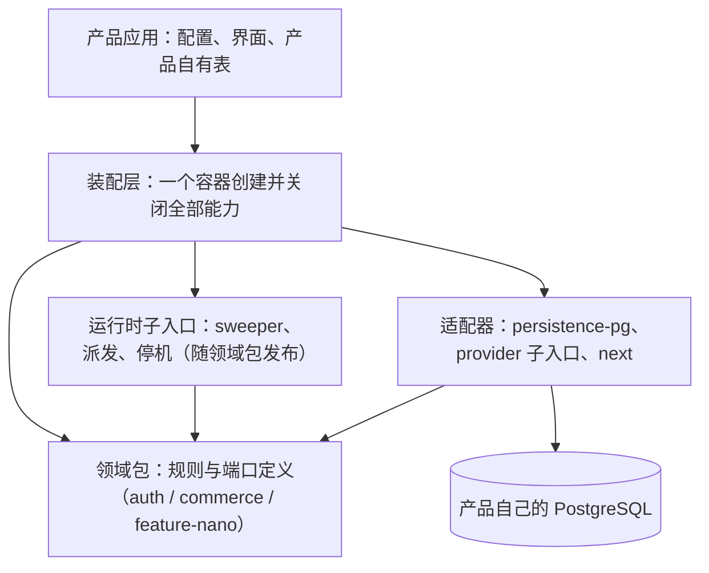

# Nexty 平台长期规划（2026-11-11）

本文回答三个问题：平台最终要长成什么样、按什么顺序走过去、每一步怎么判断走完了。
它只定方向、边界和验收口径，不写具体改法。具体改动拆成任务卡交给实施模型，近期的卡见
[`2026-11-11-nano-followups.md`](2026-11-11-nano-followups.md)。

本文是规划建议，不是批准结论，也不替代 [`docs/platform-architecture.md`](../platform-architecture.md)
描述的现行合同。两者冲突时以现行合同为准，直到对应阶段完成并更新合同。

## 1. 目标

把 BiuBiuNiu 的 Auth、组织、计费积分和 Nano 能力沉淀成版本化的包，让**第二个独立产品用装配而不是
复制**的方式获得这些能力。

衡量标准只有一条：第二个产品上线一项已有能力时，需要写的是配置和产品自己的界面，不需要从
`apps/web` 复制文件，也不需要读平台源码才能装起来。

## 2. 现状判断

已经做对的，后面不要推翻：

- 模块化单体，一个产品一个数据库，不做微服务。
- 能力包根入口不读环境变量、不依赖框架；环境和连接都由应用装配层注入。
- Nano 的正确性靠数据库 CAS 加 claim token，不依赖“只有一个进程”。
- 资金动作全部在产品自己的 PG 事务里，退款有唯一约束兜底。

真正的结构性问题只有一个，其余都是它的表现：

> **平台发布的东西，参考应用自己并没有在用。**

| 平台发布了什么 | 参考应用实际用的 | 后果 |
| --- | --- | --- |
| `_niu` 迁移链和 profile | 自己的 `_n2` 链 | 第二个产品会是 `_niu` 链的第一个真实用户 |
| 只读启动兼容检查 | 没有接入 | 文档描述的保护在线上不存在 |
| `feature-nano` 领域核心 | 另有约 900 行运行时代码留在 `apps/web/src/lib/nano/` | 第二个产品要用 Nano 只能复制 |
| 各能力包 | 装配逻辑写在 `apps/web/src/composition/`，不可复用 | 每个新产品重写一遍装配 |

所以长期规划的主线是：**让参考应用成为平台的第一个真实消费者，再用第二个产品去验证。**

## 3. 目标形态

四条长期原则，后续所有设计都按它们裁决：

1. **端口归领域，适配器只实现。** 接口定义在领域包里，`persistence-pg` 和 provider 子入口去实现它。
   现在 `NanoCoordinator` 定义在适配器里，方向是反的，这也是 Nano 运行时搬不出应用的原因。
2. **只有一条迁移链。** 平台表由包内模块定义，产品自有表作为产品自己的模块挂到同一个 runner 上。
   不再有两份需要人工保持一致的 DDL。
3. **产品只写三样东西：** 配置、界面、自有表。凡是第二个产品也需要的逻辑，都不该留在 `apps/web`。
4. **发布物必须先被参考应用使用。** 一项能力在参考应用里没有走发布入口，就不算可发布。

## 4. 路线

五个阶段。每个阶段有一个明确的退出条件，没达到就不进下一阶段。阶段内的拆卡和实现交给实施模型。

### 阶段 0　稳固当前成果（现在）

- 内容：合并 unknown 自动退款等已完成的改动；做完交接文档里的 T1–T7；加一个一键起本地合成 PG 并
  跑 PG 用例的脚本。
- 为什么先做：后面每个阶段都要反复跑 PG 用例。现在每次手工对齐库名、角色、端口和变量，漏一个就是
  几十项失败，还会被误判成回归。
- 退出条件：任何实施模型拿到仓库，用一条命令就能在本地跑完全部 PG 用例，并且结果是零 skip。

### 阶段 1　参考应用改用包内迁移链

- 内容：`apps/web` 从 `_n2` 链切到包内 runner；CMS 和反馈表变成产品自有的迁移模块；启动时接入只读
  兼容检查；删除应用里重复的那套 runner。
- 关键设计点（需要先出方案再实施）：
  - **接管已有库。** 对一个由 `_n2` 建好的库，先核对物理结构与包内模块一致，再补写 `_niu` 账本，
    全程不执行任何业务 DDL。核对不过就拒绝接管，不自动修。
  - **产品自有模块。** 包内 runner 已经支持传入显式模块清单，产品表按同样的格式定义并声明对 `auth`
    的依赖。
  - **回退。** 接管只新增账本表，旧账本保留，旧版本应用仍能启动。
- 退出条件：参考应用在全新空库和已有 `_n2` 库上都只通过包内 runner 完成迁移；启动时兼容检查不过会
  拒绝启动；仓库里只剩一份平台 DDL。
- 这是**唯一不该等触发条件**的结构性改动。拖下去的代价是让第二个产品替平台试错。

### 阶段 2　第二个产品的最小样板

- 内容：在仓库里放一个只用 Auth 的私有样板应用，从本地 tarball 安装发布物，跑通注册、登录、会话和
  组织（用固定席位的静态 billing 端口）。release gate 加入 `auth` profile。
- 目的不是交付这个样板，而是**用它产出一份摩擦清单**：哪些地方必须读平台源码、哪些代码不得不从
  `apps/web` 复制、哪些依赖不该被装进来。阶段 3 做什么由这份清单决定，不由猜测决定。
- 退出条件：样板应用不含任何从 `apps/web` 复制的文件；摩擦清单成文并排好优先级。

### 阶段 3　把可复用的东西从应用里下沉

按阶段 2 的清单做。预期会包含下面几项，但以清单为准：

- **Nano 运行时下沉。** 端口定义移到 `feature-nano`，派发、sweeper、停机作为运行时子入口发布。
  `apps/web/src/lib/nano/` 只剩路由处理和产品配置。
- **装配容器。** 一个入口创建数据库、Auth、Commerce、Nano，并提供统一的 `close()`。参考应用和样板
  应用用同一个容器，各自只传配置。四种生命周期写法到这里自然收敛。
- **`persistence-pg` 的内部依赖改成可选 peer。** 只用 Auth 的产品不再被 Commerce 和 Nano 的版本牵着走。
- 退出条件：样板应用加上 Nano 能力时，新增的只有配置、路由和界面；`apps/web` 里不再有第二个产品
  也需要的逻辑。

### 阶段 4　运营能力

平台能被装配之后，补上“能长期运行”所需的东西。这些都依赖业务口径，先决策再做：

- **可观测性。** unknown 数量、自动退款数量、派发耗时变成可查询的指标。现在只有日志。
- **数据留存。** 输入图和结果图的保留期，以及到期清理。定了之后再把图片迁出 PG 行。
- **停机排空。** 由应用接管信号处理，在宽限期内等待在途调用。现在只做到停止领取。
- **团队内可见性。** 成员能否互相查看和取消任务。
- 退出条件：以上四项各有明确的产品决定，并且实现与决定一致。

### 阶段 5　对外发布

真实 registry、SSO、存量数据升级演练。这些已在 `TODO.md` 的外部待验里，都需要外部授权和合同，
不由工程节奏决定。前四个阶段完成之前不推进，因为此前发布物的形状还会变。

## 5. 触发后再做的事

下面这些现在不做，出现对应信号时再立项：

| 事项 | 触发信号 |
| --- | --- |
| 独立 Nano Worker | 需要跨实例的全局并发配额；或单次生成时长超过平台的停机宽限期；或改为 serverless 部署 |
| 全局并发控制 | 部署超过一个实例，并且 provider 配额成为瓶颈 |
| 把 `persistence-pg` 拆成多个包 | 可选 peer 方案被证明走不通 |
| 多产品共享一个数据库 | 出现明确的产品需求，并且愿意为订单和订阅表加产品维度 |
| 管理员人工处置 unknown | 自动退款的量大到需要人工复核，或出现需要“不退款”的情形 |

## 6. 明确不做

- 不拆微服务，不做跨库事务，不做统一的租户控制面。
- 不为了命名整齐去改包前缀或挪目录。
- 不在没有第二个真实消费者的情况下抽象新接口。先有两个用例，再抽象。

## 7. 需要你决定的事

| # | 决定 | 影响哪个阶段 |
| --- | --- | --- |
| 1 | 第二个产品先要哪些能力：只要 Auth，还是 Auth 加积分，还是也要 Nano | 决定阶段 2 样板的范围和阶段 3 的优先级 |
| 2 | 是否接受阶段 1 在第二个产品开工之前完成 | 不接受的话，第二个产品要承担 `_niu` 链首次实战的风险 |
| 3 | 图片保留期、团队内任务可见性 | 阶段 4 |
| 4 | provider 返回 5xx 时是否立即退款 | 阶段 4，取决于 provider 计费口径 |

## 8. 怎么把工作交给实施模型

- **每个阶段先出一页设计说明**：边界、数据合同是否变化、验收用例清单、回退方式、停止条件。
  这一页由主控或架构节点写并经你确认，再拆卡。
- **卡的粒度**：一张卡一个写集、一组验收命令、一次 Review。跨包的重构（阶段 1 的接管、阶段 3 的
  下沉）交给能力强的模型；单文件修正、补测试、改文档交给轻量模型。
- **验收先于实现**：每张卡先写会失败的测试，再改代码。数据库相关的卡必须在本地合成 PG 上实跑，
  skip 不算通过。
- **实施与评审分离**保持不变，实施模型不批准自己的交付。
- **不变量**写进每张卡，不靠实施模型自己记得：产品 ID 的取值不能变；迁移只增不改；资金动作必须与
  状态转换在同一事务；不读真实凭据，不连非合成库。
