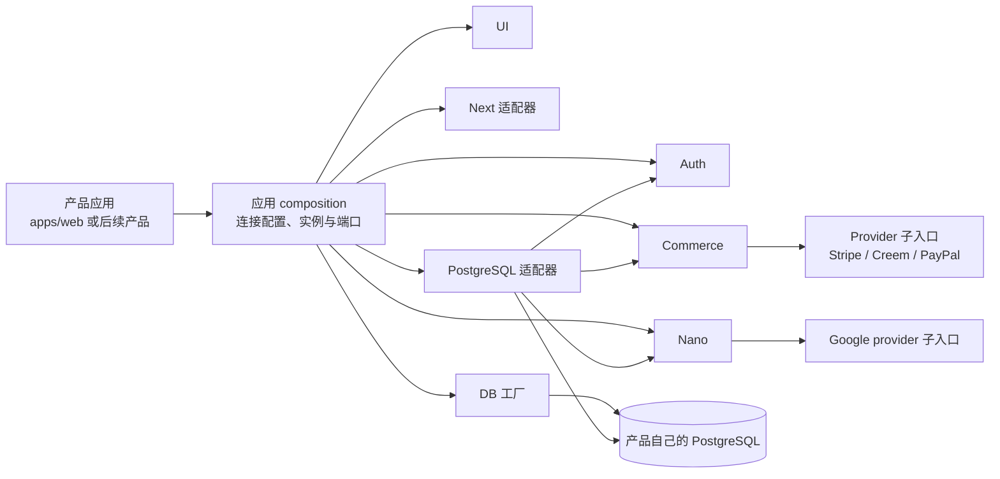
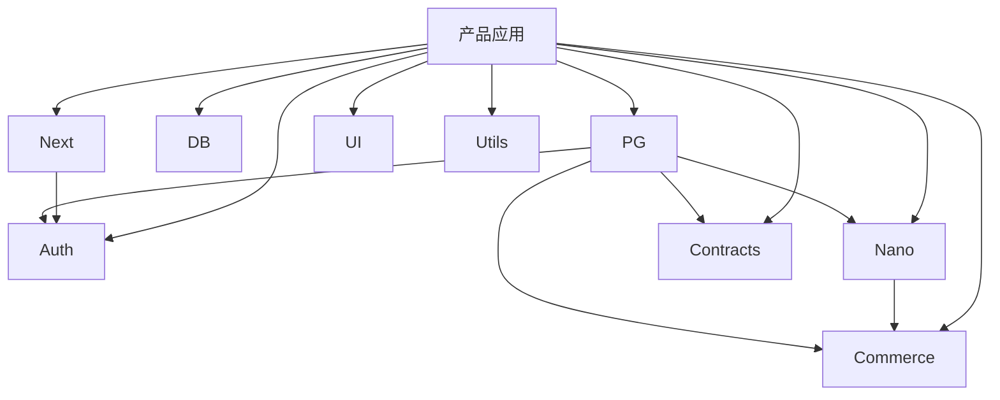

# Nexty 模块化单体与版本包架构

本文描述 Nexty 平台当前源码已经提供的架构边界。平台采用模块化单体：一个产品应用负责
组合能力包、产品配置和服务进程，能力通过明确的 TypeScript 端口连接；数据、认证、结算和
Nano 任务仍运行在同一产品应用的部署边界内。

本文描述可随仓库长期维护的源码合同。具体验收状态由对应交付任务的独立 Review 和正式
报告判定；实施报告本身不代表批准。

## 1. 总体形态

应用是装配和业务用例的拥有者。产品配置、环境变量、请求上下文、日志、邮件、UI 文案、
CMS、反馈和具体外部服务连接都留在应用层；可复用包只接收依赖或公开端口。一个产品应用
可以运行多个能力，但不会因为拆包而自动变成微服务。

## 2. 十个发布物

发布集合由九项能力包和 `@sunpcm/niu-prettier-config` 组成，共十项：

| 包 | 职责 | 关键入口 |
| --- | --- | --- |
| `@sunpcm/niu-contracts` | 跨边界原语、错误和标识符 | 根入口 |
| `@sunpcm/niu-utils` | 无框架格式化和字符串工具 | 根入口 |
| `@sunpcm/niu-auth` | Better Auth 工厂、认证规则和纯 Node guards | 根入口；`/client` |
| `@sunpcm/niu-commerce` | 订单、订阅、积分和退款领域逻辑 | 根入口；`/providers/stripe`、`/providers/creem`、`/providers/paypal` |
| `@sunpcm/niu-ui` | React 组件、hooks、主题和预编译 CSS | 根入口；组件、`/cn`、hook、`styles.css` |
| `@sunpcm/niu-db` | 显式 PostgreSQL/Drizzle 连接工厂 | 根入口 |
| `@sunpcm/niu-next` | Next 认证服务端适配和客户端薄转发 | 根入口；`/client` |
| `@sunpcm/niu-feature-nano` | Nano 纯领域、provider 端口和 React hook | 根入口；`/provider/google`、`/react` |
| `@sunpcm/niu-persistence-pg` | Migration、schema slices 和 PG 适配器 | 根入口；`/migrations`、`/schema/*`、`/auth`、`/commerce`、`/nano` |
| `@sunpcm/niu-prettier-config` | 仓库共享的 Prettier/Tailwind 插件配置 | 配置包根入口 |

发布成员由 [release/packages.json](../release/packages.json) 的显式 allowlist 固定；
[release-artifacts.test.mjs](../test/packages/release-artifacts.test.mjs) 验证该集合、
包身份和依赖闭包合同。实际发布顺序由
[inspect.mjs](../scripts/release/lib/inspect.mjs) 根据强依赖和 optional 边执行 leaves-first
拓扑计算，不依赖 allowlist 的数组顺序或测试文件中的声明顺序。

各包的 `exports` 是实际消费者合同，以各包 `package.json` 为准；应用不能用源码路径绕过
发布入口。

## 3. 依赖方向

依赖规则由
[dependency-boundaries.mjs](../scripts/dependency-boundaries.mjs) 检查：

- `contracts` 和 `utils` 是叶子包，不依赖框架、数据库或 provider SDK。
- `auth`、`commerce` 的根入口不泄漏 Next、Drizzle、PostgreSQL 或业务 `process.env`。
- `feature-nano` 根入口只含纯 TypeScript 和 Commerce 类型，不导入 React、Google SDK、
  Next、数据库或环境变量；这些依赖只在显式子入口出现。
- `next` 通过 peer 依赖消费 `auth`，认证决策仍留在 `auth`。
- `persistence-pg` 从根入口导出 migration 合同，不聚合 schema；Auth、Commerce、Nano
  schema 与适配器必须从具体子入口导入。
- 应用可以依赖全部包，包不能反向依赖应用。工作区包之间禁止循环依赖。

`persistence-pg` 的源码依赖同时包含 `auth`、`commerce`、`contracts` 和
`feature-nano`，见
[persistence-pg/package.json](../packages/persistence-pg/package.json)。因此按 profile
裁剪数据库表不会同步裁剪 npm 安装图。

## 4. 应用装配与环境归属

参考应用把装配集中到 `apps/web/src/composition`：

- [db.ts](../apps/web/src/composition/db.ts) 把显式连接串交给
  `@sunpcm/niu-db`，创建应用单例，并根据部署平台和数据库位置决定连接参数。
- [auth.ts](../apps/web/src/composition/auth.ts) 绑定 Better Auth adapter、Auth policy
  store、Commerce billing port、邮件、请求信号、Redis、secret 和产品能力。
- [commerce.ts](../apps/web/src/composition/commerce.ts) 绑定一份 catalog、PG store、
  身份端口、通知器、commit 后调度器和 `productId`。
- [nano.ts](../apps/web/src/composition/nano.ts) 复用同一数据库、Commerce 实例与 PG
  store，注入产品案例、模型、成本、限流参数和 Google provider。

环境变量由应用读取，不进入能力包根入口。以下是装配层的归属示例，不是跨产品共享密钥的
约定：

- `DATABASE_URL` 选择当前产品的数据库；
- `NEXT_PUBLIC_SITE_URL`、产品目录和价格表定义产品身份与展示；
- `DISABLE_PURCHASE`、`DISABLE_NANO` 控制新接纳；
- `GOOGLE_GENERATIVE_AI_API_KEY` 只决定 Nano provider 是否可用；
- `NANO_MODEL`、并发、批大小、lease 和轮询间隔属于服务端产品配置。

客户端只接收经过投影的 DTO。Nano 的公开配置不包含密钥、模型标识或原始 provider
配置，见 [config/nano.ts](../apps/web/src/config/nano.ts)。

## 5. Auth、Commerce 与 Nano

### Auth 使用 fresh 状态

`@sunpcm/niu-auth` 的 `getFreshSession` 会禁用 cookie cache 和 session refresh，再读取
当前封禁状态；Next 适配器只把结果按请求做 React cache，不跨请求缓存可信角色。
工作区上下文还会重新验证用户仍是 active organization 的 live member。相关实现见
[guards.ts](../packages/auth/src/guards.ts) 和
[next/src/index.ts](../packages/next/src/index.ts)。

### 组织席位与 Commerce

组织插件先做席位预检，并在插入 invitation/member 后执行补偿。补偿事务获取
`org-seats-<organizationId>` advisory lock，在同一 PG 事务和连接上读取 Commerce 席位，
重新计数，只删除本次新增的 member 或 invitation；超额时在补偿提交后再向调用方报错。
见 [organization.ts](../packages/auth/src/organization.ts) 和
[persistence-pg/auth/index.ts](../packages/persistence-pg/src/auth/index.ts)。

这保证并发席位收敛，但 Better Auth 的原始插入和后续补偿不是同一个巨大事务；补偿前存在
极短的超额窗口。删除组织、注销用户前也会检查 live subscription 和 billing history。

### Commerce 事务

`createCommerce` 接收应用注入的 catalog、clock、store、identity、notifier、logger 和
post-commit scheduler。PG store 可以打开一个 owned transaction，并让调用者通过
`commerce.join(unit)` 在同一 unit 上执行订单、订阅和积分操作。提交后才刷新
post-commit 工作，回滚则丢弃。见
[commerce/index.ts](../packages/commerce/src/index.ts) 和
[persistence-pg/commerce/index.ts](../packages/persistence-pg/src/commerce/index.ts)。

### Nano 持久任务

Nano 状态为 `queued -> leased -> dispatching -> running -> ...`，终态为
`succeeded`、`failed` 或 `canceled`；不确定结果使用 `unknown`。

1. 接纳任务时，幂等检查、积分扣减、`spendTxId` 关联、活动任务记录和待扫描意图在同一
   产品-owned PG 事务内完成。
2. 进程内 scheduler 先派发 queued 任务，再收尾已持久化结果，然后把失去结果且 lease
   过期的 in-flight 任务标成 `unknown`，最后处理超期的 `unknown`（见第 4 条）。各步互相隔离，
   前一步失败不会跳过后面的收敛步骤。
3. 远程 provider 调用不持有数据库事务。每次派发生成随机 claim token；后续状态推进用
   owner、token 和状态做 compare-and-swap。
4. 确定失败或 queued 取消只有在 CAS 成功后，才在同一事务中退款。`unknown` 不会在缺少
   provider 查询/幂等合同时盲目重发。没有持久化结果的 `unknown` 停留超过
   `NANO_UNKNOWN_REFUND_AFTER_MS`（默认 15 分钟）后，由 scheduler 用一次不带 claim 的 CAS
   改为 `failed`，在同一事务中退款、清除 lease 并释放 active job。此后迟到的结果无法再写入，
   所以不会出现“既退款又交付”。进入 `unknown` 和超期退款各记一条只含稳定 code 与任务 id 的日志。
5. 关闭新接纳后，只要 provider 仍配置，已接纳任务可以继续收尾；没有 provider 时仍可
   完成 staged result 和 stale-in-flight 收敛。

实现见
[feature-nano/core.ts](../packages/feature-nano/src/core.ts)、
[persistence-pg/nano/index.ts](../packages/persistence-pg/src/nano/index.ts)、
[nano/runtime.ts](../apps/web/src/lib/nano/runtime.ts) 和
[nano/dispatch.ts](../apps/web/src/lib/nano/dispatch.ts)。

## 6. Migration profile 与数据库合同

迁移模块是静态、显式导入的 append-only manifest。当前
`DATABASE_CONTRACT_VERSION` 为 `1`，每个模块另有自身 `version` 与 `contractVersion`。

| Module | 直接依赖 | 物理对象 |
| --- | --- | --- |
| `auth` | 无 | user、session、account、verification、organization、member、invitation 等身份/组织表 |
| `payments` | `auth` | orders、subscriptions 和 billing enums |
| `credits` | `auth`、`payments` | 两个余额表和 append-only 积分流水 |
| `nano` | `auth`、`credits` | persistent tasks、active jobs、case-selection stats |

| Profile | 解析后的模块闭包 |
| --- | --- |
| `minimal` | 无业务模块，只创建 migration journal/profile metadata |
| `auth` | `auth` |
| `auth_credits` | `auth`、`payments`、`credits` |
| `nano_payments` | `auth`、`payments`、`credits`、`nano` |

`nano` 因 `spend_tx_id` 引用积分流水而依赖 `credits`；`credits` 因 `order_id` 引用订单而
依赖 `payments`，所以 profile 会自动展开完整闭包。规划器在执行 SQL 前拒绝未知模块、
缺失依赖、重复模块和循环。见
[profiles.ts](../packages/persistence-pg/src/migrations/profiles.ts) 和
[planner.ts](../packages/persistence-pg/src/migrations/planner.ts)。

写迁移时，整个批次在一个事务内获取 advisory lock、校验数据库身份、执行 DDL 并写
`_niu_migration_journal`/profile metadata；失败整体回滚。已经记录的 module version、
contract version 或 checksum 不得漂移。

启动兼容检查是只读的：不建 journal、不执行 DDL、不自动迁移，同时核对 journal、支持的
contract version、sentinel table/column 和物理 schema。见
[runner.ts](../packages/persistence-pg/src/migrations/runner.ts)。

## 7. 版本合同、兼容与回退

- npm 包版本、模块 `version`、数据库 `contractVersion` 是三个不同层面，不能相互代替。
- 破坏性数据库变化增加新的 append-only module 并提升 contract version；纯增量模块复用
  contract version。
- 发布包内的强内部依赖必须指向精确兼容版本，`next -> auth` 等 peer 合同也必须可满足；
  完整十项闭包一起发布和验证。
- 新应用连接旧数据库时先显式运行迁移，再通过只读兼容检查；旧应用连接新数据库时，只有
  其支持范围包含数据库合同版本才允许启动。
- 应用回退成立的前提是旧消费者接受当前数据库合同且物理 schema 仍是其兼容子集。当前
  架构没有 down migration，也没有“回退时自动删除表/列”的承诺；不能安全回退的版本应
  先修复前向兼容，而不是手工降级生产 schema。

## 8. 每产品隔离边界

每个产品应独立拥有配置、`DATABASE_URL`、迁移执行、进程生命周期和部署 namespace。
这样可以独立升级、回退和恢复，也避免一个产品的 migration 或 provider 故障影响另一个
产品。

Commerce 实例必须收到非空 `productId`；Nano coordinator 要求自己的 `productId` 与
绑定 Commerce 完全一致，并在查询、claim 和 case stats 中按产品过滤。参考应用默认用
`apps/web/src/config/product.ts` 的 `PRODUCT_ID` 常量，其他产品可以显式注入自己的稳定产品 ID。
这个值会落库并参与所有 Nano 查询的过滤，它是标识符而不是展示名：改品牌名不能改它，改它需要数据迁移。

当前 schema 合同按“一个产品一个数据库”设计，不承诺多个产品共享同一 PostgreSQL
database 时的完整租户隔离。尤其 Commerce 的订单和订阅表没有可替代数据库边界的
`product_id` 列；不要依赖 Nano 已有的产品过滤推导整个共享库已经安全。跨产品数据共享
需要单独的产品合同和迁移，不能用跨库事务补洞。

独立数据库也不等于资源或故障隔离。多个产品共用同一 PostgreSQL 实例或集群时，仍共享
连接数、CPU、内存、存储、I/O 和故障域；本节只定义逻辑数据边界，不承诺物理故障隔离。

## 9. 当前限制与保留范围

- 进程收到停止信号后不再领取新任务，但不等待在途的 provider 调用；被中断的任务在 lease 过期后
  进入 `unknown`，再按超期策略退款。
- Nano 的并发上限和重叠 sweep 保护是进程内约束。数据库 claim 能防止旧 owner 覆盖状态，
  但不能给多实例提供全局并发配额；如需全局节流，应增加 PG 协调 lease/额度机制。
- `persistence-pg` 强依赖多个 core 包。`minimal`、`auth`、`auth_credits` 等 profile
  只控制物理 schema，不控制 npm 安装闭包。
- 组织结构、CMS、反馈、邮件模板、AI demo、存储、分析和具体 UI 文案仍属于参考应用。
  它们不会被拆包行为自动变成通用平台能力。
- 当前没有微服务拆分、跨数据库事务、统一 SSO/租户控制面，也没有真实包公开发布承诺。
- 本地构建、release consumer 和独立 Review 分别代表不同证据等级；外部 provider、登录态
  浏览器、私有 registry 和真实部署门槛仍需按正式报告核验。
